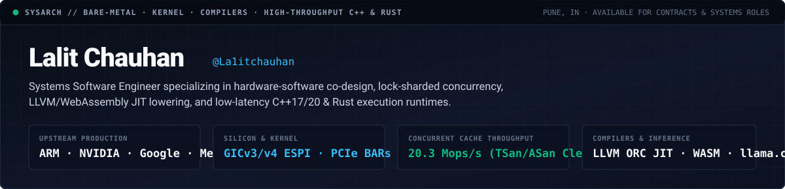
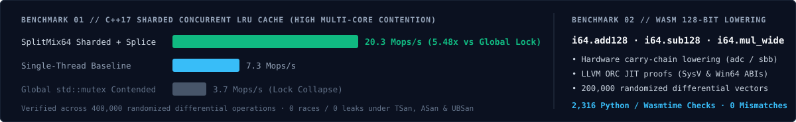

<div align="center">
  
</div>

<br />

<div align="center">
  <a href="mailto:chauhanlalitofficial@gmail.com"><code>chauhanlalitofficial@gmail.com</code></a> &nbsp;·&nbsp;
  <a href="https://www.linkedin.com/in/la1it-chauhan5/"><code>linkedin.com/in/la1it-chauhan5</code></a> &nbsp;·&nbsp;
  <a href="https://github.com/La1itchauhan?tab=repositories"><code>Systems Repositories</code></a> &nbsp;·&nbsp;
  <code></code>
</div>

---

### 01. Architectural Focus &amp; Operating Domains

I engineer low-level systems software where hardware constraints, memory lifetimes, and multi-core synchronization intersect. My work spans bare-metal silicon compliance, compiler instruction lowering, and high-throughput concurrent runtimes in **C++17/20**, **Rust**, and **C**.

<table width="100%">
<tr>
<td width="50%" valign="top">
<strong>Silicon, Bare-Metal &amp; OS Internals</strong>
<ul>
  <li><strong>ARM System Architecture</strong>: GICv3 / GICv4 Generic Interrupt Controller distributor routing, Extended Shared Peripheral Interrupts (ESPI), and bare-metal compliance verification.</li>
  <li><strong>PCIe &amp; Memory Subsystems</strong>: Base Address Register (BAR) probing, configuration space state restoration, and cache-line-aligned memory layouts.</li>
  <li><strong>Synchronization &amp; Profiling</strong>: Lock sharding, zero-allocation node splicing, POSIX concurrency, and deterministic verification under <code>ASan</code>, <code>TSan</code>, <code>UBSan</code>, and Valgrind.</li>
</ul>
</td>
<td width="50%" valign="top">
<strong>Compilers, WebAssembly &amp; AI Runtimes</strong>
<ul>
  <li><strong>LLVM &amp; JIT Pipelines</strong>: LLVM ORC JIT compilation, <code>llc</code> machine-code lowering proofs across System V (x86-64 Linux) and Windows x64 ABIs.</li>
  <li><strong>WebAssembly Internals</strong>: 128-bit wide arithmetic (<code>i64.add128</code>, <code>i64.sub128</code>, <code>i64.mul_wide</code>) using hardware carry-chains (<code>_addcarry_u64</code> / <code>adc</code> / <code>sbb</code>) and WasmEdge SIMD bytecode instrumentation.</li>
  <li><strong>Inference &amp; Spatial Engines</strong>: Constrained grammar sampling in <code>llama.cpp</code>, Rust static analysis in Meta's <code>pyrefly</code>, and spherical Hilbert-curve indexing in Google <code>s2geometry</code>.</li>
</ul>
</td>
</tr>
</table>

---

### 02. Upstream Production Ledger (Selected Pull Requests)

Production bug fixes, hardware register corrections, and runtime features authored for foundational industry repositories:

| Organization &amp; Repository | Pull Request | Subsystem &amp; Architectural Impact | Status |
| :--- | :--- | :--- | :--- |
| **`ARM-software/sysarch-acs`** | [`#653`](https://github.com/ARM-software/sysarch-acs/pull/653) | **ARM GICv3/v4 Bare-Metal**: Corrected distributor register offset calculations for Extended Shared Peripheral Interrupt (ESPI) enable and routing in ARM's official architecture compliance suite. | `Merged` |
| **`ARM-software/sysarch-acs`** | [`#664`](https://github.com/ARM-software/sysarch-acs/pull/664) | **PCIe Configuration Space**: Restored Base Address Registers (BAR) following PCIe configuration space memory sizing probes (`PCI_IN_13`), preventing downstream device map corruption. | `Merged` |
| **`NVIDIA/aicr`** | [`#3313`](https://github.com/NVIDIA/aicr/pull/3313) · [`#3293`](https://github.com/NVIDIA/aicr/pull/3293) | **NVIDIA Enterprise AI Cloud Runtime**: Fixed release boundary tag resolution across multi-package GPU runtime changelogs and scoped Flux v2 `helm-controller` migrations for NVIDIA Network Operator. | `Merged` |
| **`ggml-org/llama.cpp`** | [`#30722`](https://github.com/ggml-org/llama.cpp/pull/30722) | **C++ LLM Inference Runtime**: Gated reasoning/thinking token emission on `enable_thinking` within the Gemma-4 constrained schema grammar engine. | `Open` |
| **`google/s2geometry`** | [`#701`](https://github.com/google/s2geometry/pull/701) | **Computational Spherical Geometry**: Implemented zero-overhead `pybind11` sequence construction and tuple unpacking for C++ `S2Point` primitives (`#550`). | `Open` |
| **`facebook/pyrefly`** | [`#5287`](https://github.com/facebook/pyrefly/pull/5287) | **Rust Static Type Checker &amp; LSP**: Suppressed redundant inlay hints on matching identifier names inside Meta's Rust-based Python language server. | `Open` |
| **`AcademySoftwareFoundation`** | [`#2055`](https://github.com/AcademySoftwareFoundation/OpenTimelineIO/pull/2055) · [`#3087`](https://github.com/AcademySoftwareFoundation/MaterialX/pull/3087) · [`#309`](https://github.com/AcademySoftwareFoundation/rawtoaces/pull/309) | **High-Performance C++ Media &amp; Graphics**: Eliminated null-pointer dereference in `OpenTimelineIO` (`Composable::available_image_bounds`), fixed macOS Retina high-DPI viewport scaling in `MaterialX`, and isolated modular unit test boundaries in `rawtoaces`. | `Merged` |
| **`goharbor/harbor` (CNCF)** | [`#23646`](https://github.com/goharbor/harbor/pull/23646) | **Cloud-Native Registry**: Fixed SBOM artifact table column layout constraints for enterprise vulnerability inspection workflows. | `Merged` |

---

### 03. Systems Engineering Benchmarks &amp; Reference Implementations

<div align="center">
  
</div>

<br />

<table width="100%">
<tr>
<td width="50%" valign="top">
<h4><a href="https://github.com/La1itchauhan/lru-cache"><code>La1itchauhan/lru-cache</code></a> — 20.3 Mops/s Sharded C++17 Cache</h4>
<p>
Thread-safe, $O(1)$ concurrent LRU and FIFO cache engine engineered to eliminate multi-core lock collapse.
</p>
<ul>
  <li><strong>Architecture</strong>: Cache-line-aligned <code>SplitMix64</code> hash sharding paired with zero-allocation <code>std::list</code> node splicing on cache hits.</li>
  <li><strong>Throughput</strong>: Scales from <strong>7.3 Mops/s</strong> (single-thread) to <strong>20.3 Mops/s</strong> under heavy multi-core contention where global mutexes degrade to <strong>3.7 Mops/s</strong>.</li>
  <li><strong>Verification</strong>: 400,000-operation randomized differential test harness; verified zero data races and zero leaks under <code>TSan</code>, <code>ASan</code>, and <code>UBSan</code>.</li>
</ul>
</td>
<td width="50%" valign="top">
<h4><a href="https://github.com/La1itchauhan/wide-arith-primitives"><code>La1itchauhan/wide-arith-primitives</code></a> — WASM 128-Bit Primitives</h4>
<p>
Portable C++17 and hardware carry-chain implementation of the WebAssembly Wide Arithmetic specification.
</p>
<ul>
  <li><strong>Architecture</strong>: Implements <code>i64.add128</code>, <code>i64.sub128</code>, <code>i64.mul_wide_s</code>, and <code>i64.mul_wide_u</code> lowering to native x86-64 <code>adc</code>/<code>sbb</code> (<code>_addcarry_u64</code>) and <code>__int128</code>.</li>
  <li><strong>JIT &amp; Runtime Proofs</strong>: Engineered companion LLVM ORC JIT lowering proofs across SysV and Win64 ABIs alongside WasmEdge fixed-width SIMD dispatch instrumentation.</li>
  <li><strong>Verification</strong>: 200,000 randomized cross-checks + 2,316 Python arbitrary-precision differential test vectors + hand-encoded WAT modules validated on <code>wasmtime</code>.</li>
</ul>
</td>
</tr>
</table>

---

### 04. Technical Specification Matrix

```text
LANGUAGES         C++ (C++17 / C++20) · Rust · C · Python · Assembly (x86-64 / ARM64 / WebAssembly WAT) · Bash
HARDWARE / OS     ARM GICv3/v4 (ESPI) · PCIe Config Space & BARs · Linux Kernel Sync · POSIX Threads · RF SDR / FFT
COMPILERS / VM    LLVM C++ API & ORC JIT · WebAssembly (WasmEdge / wasmtime) · llama.cpp (GGUF / Grammars) · pybind11
VERIFICATION      AddressSanitizer (ASan) · ThreadSanitizer (TSan) · UBSan · Valgrind · GDB / LLDB · Differential Fuzzing
BUILD / INFRA     CMake · Ninja · Make · Cargo · Git · Docker · Kubernetes / Flux GitOps
CREDENTIALS       B.E. ENTC, Army Institute of Technology (AIT) Pune (2022–2026) · PM's Scholarship Scheme (PMSS) Scholar
                  Winner, Vulcan 2024 Tech Innovation Research Paper · Finalist, CodeFT 3.0 Competitive Programming
```
